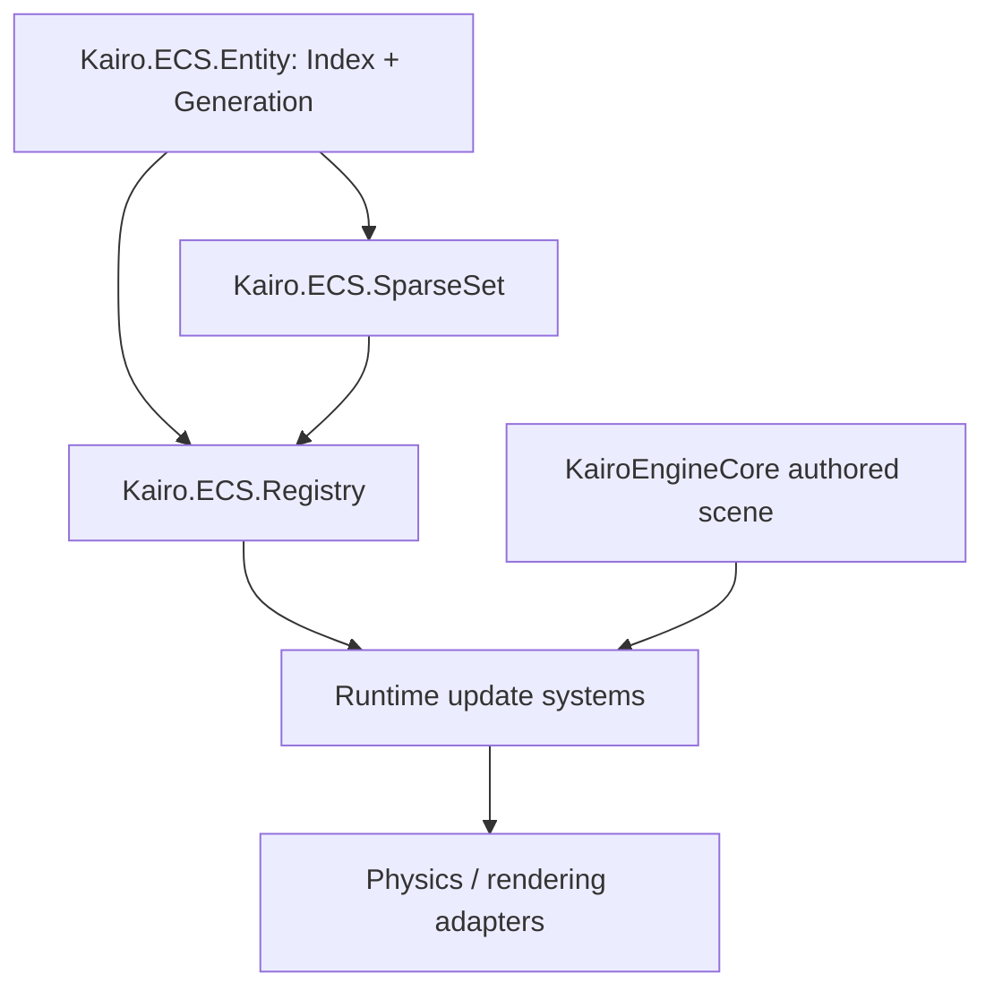

# Understanding KairoECS from first principles

Read this after the [source reading map](SOURCE_READING_ORDER.md). The files are deliberately small, but the relationships between entity identity, dense storage, iteration and lifetime are core engine design decisions.

## 1. Why a scene is not an ECS

A scene usually describes *authored* identity and persistence: which objects exist, their names, transforms and serialization. An Entity-Component-System (ECS) instead organizes runtime state so game/simulation systems can read homogeneous components efficiently.

KairoEngineCore owns the scene/application layer. KairoECS intentionally does **not** own windows, asset parsing, scene files, physics or renderer resources. Runtime integration uses adapters and stable IDs. That separation makes the ECS testable without a GPU.

## 2. Three small modules, one contract



- [Entity.cppm](../Entity.cppm) defines a value handle `{Index, Generation}`. An index can be reused, but an old generation cannot refer to a new lifetime.
- [SparseSet.cppm](../SparseSet.cppm) stores one component type's data in contiguous arrays, with a sparse entity-index map.
- [Registry.cppm](../Registry.cppm) allocates entities, owns one sparse pool per C++ component type, records mutations and runs joins.
- [KairoECS.cppm](../KairoECS.cppm) is an umbrella C++23 module: `import Kairo.ECS` reexports the pieces.

## 3. Entity validity has two meanings

`Entity::IsValid()` only says the index is not the reserved sentinel. `Registry::IsAlive(entity)` additionally verifies that the index is allocated, live and has the current generation. This distinction makes stale handles safe to reject even if the same numeric slot has been reused.

Imagine entity `{Index=4,Generation=1}` is destroyed. The slot may be reused as `{4,2}`. Calling `Get<Position>` using `{4,1}` must not access the new entity's position. The registry and sparse set both take part in enforcing this.

## 4. The sparse-set layout

For a component such as `Position`, the structure resembles:

```text
Entity.Index:       2       7       12
Sparse table:       1       0        2     -> dense indices
Dense Entities:   {7,g}   {2,g}    {12,g}
Dense Position:   [p7]    [p2]     [p12]
```

A lookup uses the sparse index, then checks that the full stored Entity (including generation) matches. Successful lookup is O(1) and dense iteration is cache-friendly. Removal swaps the final dense element into the deleted slot and updates the moved entity's sparse index, avoiding O(n) middle deletion.

**Trade-off:** dense ordering is not stable across removals. References, pointers, indices and iterators can become invalid after insertion/reallocation/removal. A callback passed to `Registry::Each` must not structurally modify a pool it is iterating. The implementation also marks `SparseSet::Remove` `noexcept` while moving components; component types with potentially throwing move assignment need a separate safety review.

## 5. A real component update

```cpp
import Kairo.ECS;

struct Position { float x = 0, y = 0, z = 0; };
struct Velocity { float x = 0, y = 0, z = 0; };

int main() {
    kairo::ecs::Registry world;
    auto entity = world.Create();

    // Registry validates the live handle and constructs data in the
    // type-specific SparseSet. This does not add a mesh to the GPU.
    world.Emplace<Position>(entity, 1.0f, 2.0f, 3.0f);
    world.Emplace<Velocity>(entity, 0.5f, 0.0f, -0.25f);

    // Iteration scans the smaller dense pool and resolves the other
    // component in O(1) sparse lookup. Do not add/remove either
    // component or destroy entities inside this callback.
    world.Each<Position, Velocity>(
        [](kairo::ecs::Entity, Position& p, Velocity& v) {
            p.x += v.x;
            p.y += v.y;
            p.z += v.z;
        }
    );

    // Destroy removes attached components before the entity slot can
    // be reused, making a previously held generation stale.
    world.Destroy(entity);
}
```

`Each<First,Second>` chooses the smaller of two dense sets and looks up the other type. `Each<First,Second,Third>` extends this idea to three types. This is a data-oriented optimization, not a guarantee that a GPU renderer or physics engine uses it without adapters.

## 6. Structural-change journal

The registry records `Created`, `Destroyed`, `ComponentAdded` and `ComponentRemoved` with monotonically increasing sequence IDs. The journal retains a bounded recent history (default capacity 4096). Tools and future replication can consume snapshots, but a bounded journal is not a complete replay archive. When the journal fills, oldest entries are removed.

Notice that mutation methods reserve journal capacity before changing ECS state, reducing the risk of leaving a successful change unrecorded due to allocation failure. The journal has its own trade-off: when full, removal of the first vector element shifts remaining entries.

## 7. Performance evidence and tests

[ECSTests.cpp](../tests/ECSTests.cpp) uses Catch2 to test stale handles, duplicate components, joins, journal behavior, preallocation, and destruction semantics. The assertion macros belong to Catch2, not ECS.

[ECSBenchmark.cpp](../benchmarks/ECSBenchmark.cpp) prepares many entities, assigns `Position` and `Velocity` broadly and `Active` sparsely, then times 120 multi-component update passes. Its JSON throughput is a single-workload microbenchmark; it does not prove superiority to other ECS architectures or production games.

To build with a C++23 module-capable compiler, follow the actual [CMake configuration](../CMakeLists.txt), enable tests, and run CTest. A successful compiler run covers the tested host only; no new build was executed for this teaching annotation branch.

## 8. Exercises

Start by hand-simulating insertion/removal and updating the sparse/dense indices. Then add a test for stale-generation access, one for a three-component join with a rare type, and a test verifying journal retention when it exceeds its capacity. Finally, benchmark a sparse `Active` mask against a dense mask and explain why iteration cost changes.

The recurring questions are: who owns this state, what can invalidate a reference, where is the input checked, what runtime component consumes the result, and what test actually establishes the behavior?
